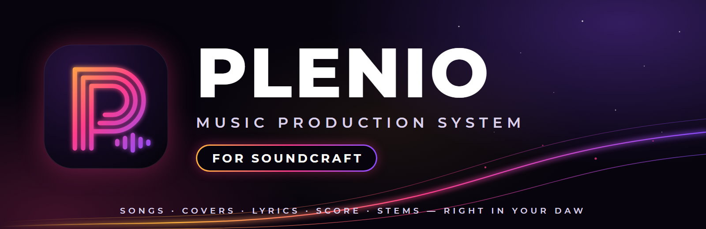
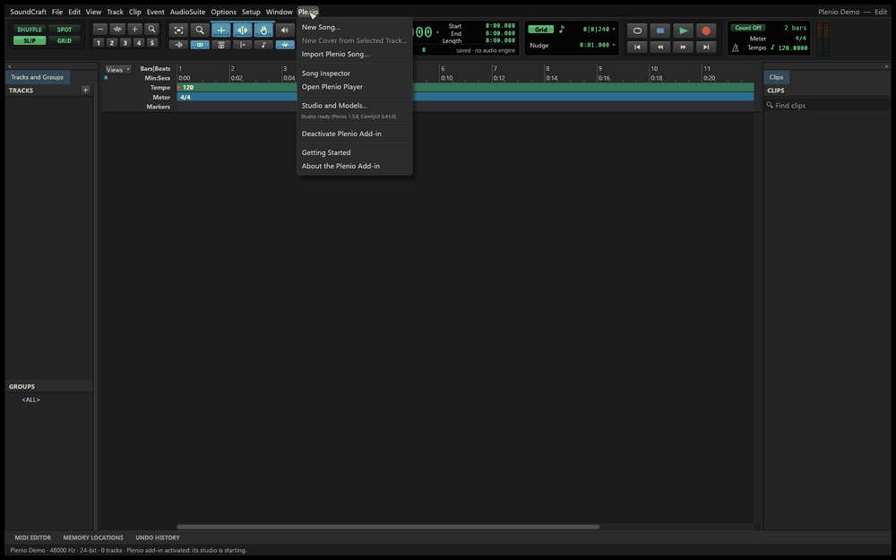
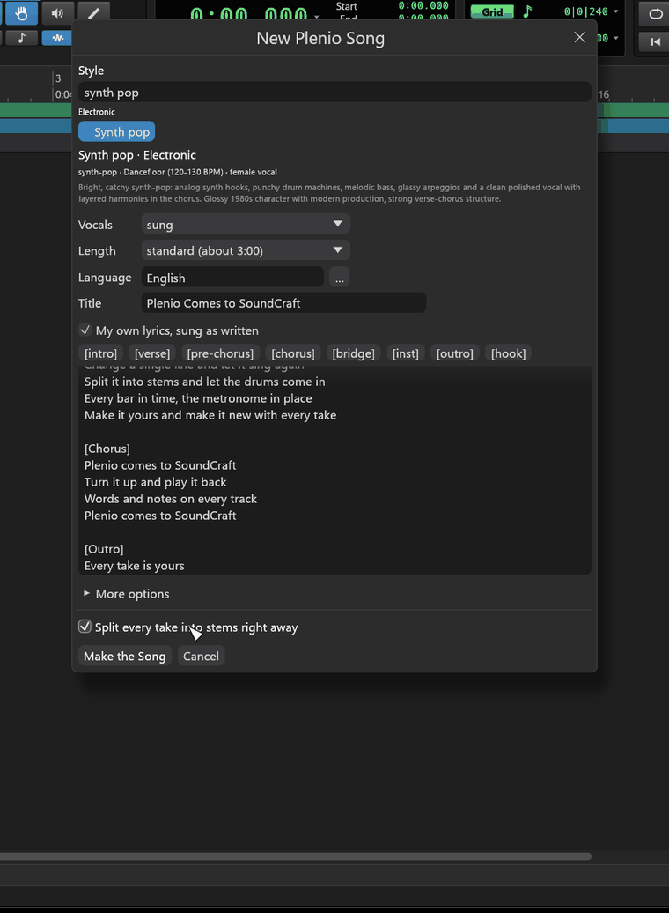
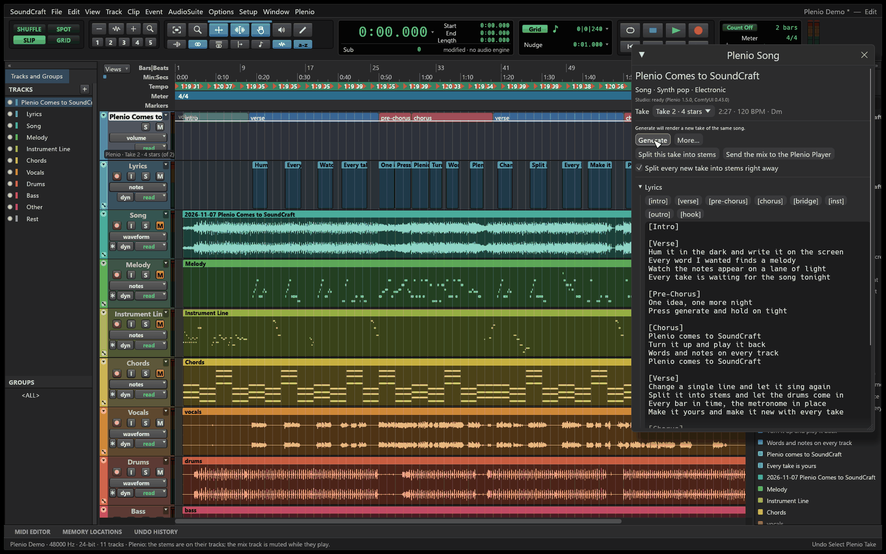
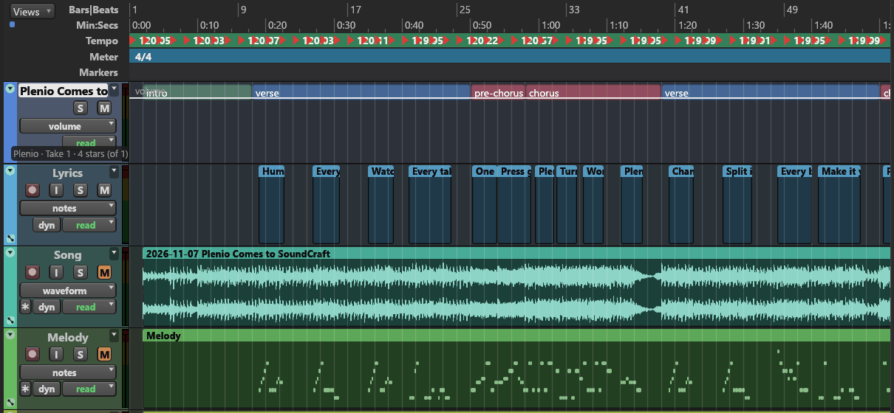
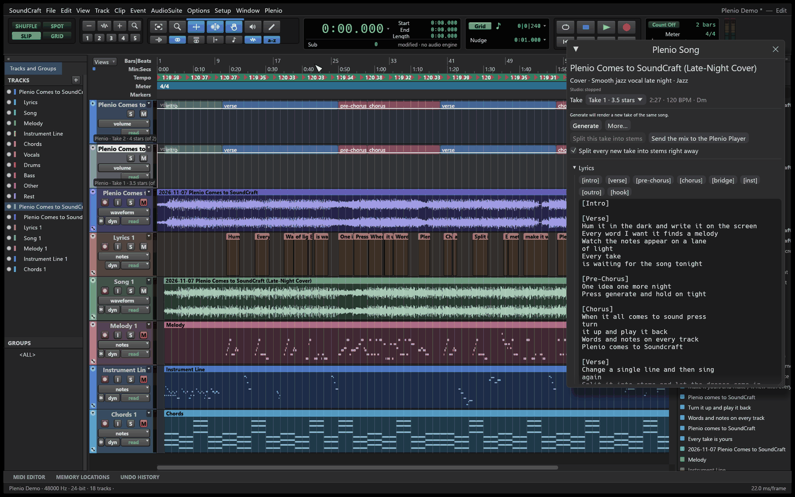
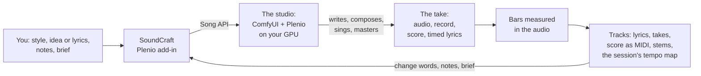

<p align="center">
  
</p>

<p align="center">
  <b>Write the words. Generate the song. Edit every take.</b><br>
  AI songs and covers made with YuE2, right inside SoundCraft, the open-source DAW written in Rust:<br>
  the lyrics, the score, every take and the stems arrive as real tracks you can edit, mix and make again.
</p>

<p align="center">
  <a href="addins/plenio/CHANGELOG.md"></a>
  <a href="#license"></a>
  
  
  
</p>

<p align="center">
  <a href="https://github.com/jplenio/soundcraft-plenio/releases/tag/plenio-v0.1.0-alpha"><b>▶ Teaser</b></a> ·
  <a href="addins/plenio/docs/TUTORIAL.md"><b>Tutorial</b></a> ·
  <a href="https://github.com/jplenio/soundcraft-plenio/releases"><b>Download</b></a> ·
  <a href="addins/plenio/README.md"><b>User guide</b></a> ·
  <a href="addins/plenio/CHANGELOG.md"><b>Changelog</b></a>
</p>

<p align="center">
  
</p>

## Why

Music generators hand you a finished audio file. A producer needs the parts: the words where they are
sung, the notes, the takes to choose from, the stems to mix. **Plenio for SoundCraft** brings the
[Plenio Music Production System](https://github.com/jplenio/Plenio-Music-Production-System) into a real
DAW, so a generated song is the start of a production, not the end of one.

- 🎛️ **Everything on tracks.** A song is a folder: its lyrics (a clip per sung line), its audio (every take
  on its own playlist), its score as MIDI (melody, instrument line, chords) and its stems.
- ⏱️ **In time, bar by bar.** AI renders do not keep a steady tempo. The add-in measures every bar in the
  audio and writes it into the session's tempo map, so the metronome, the grid and your own MIDI stay on the
  music. The audio is never stretched.
- 🔁 **Make it again, exactly where you changed it.** Change a line of the lyrics and Generate composes
  new notes for it; change a note and it is sung as written; change the brief and the song is written anew.
- 🎨 **Covers of any recording**, in any of 250 styles, with the original lyrics, new ones or none.
- 🔒 **On your computer.** YuE2 runs on your graphics card in a ComfyUI of the add-in's own; nothing leaves
  your machine but the model downloads.
- 🧩 **Open.** Free and open source, every step one undoable command, reachable from SoundCraft's control
  channel and MCP.

## What it looks like

<table>
<tr>
<td width="50%"></td>
<td><h3>New Song</h3>
Search 250 styles, from synth pop to late-night jazz. Say in a sentence what the song is about, or write
your own lyrics, sung as written. <b>More options</b> holds every field of Plenio's Song API: genre,
mood, tempo, key, meter, voice, arrangement, creativity, lyrics fidelity, HQ mastering and more. Tick
<b>Split every take into stems right away</b> and the stems come with each take.</td>
</tr>
<tr>
<td colspan="2"></td>
</tr>
<tr>
<td colspan="2"><p align="center">The song on its tracks: sections on the lane, lyrics where they are sung, the take, the score as
MIDI, the stems, and the <b>Plenio Song</b> inspector with takes, lyrics, brief and seeds.</p></td>
</tr>
<tr>
<td></td>
<td><h3>The audio is the master</h3>
Every measure of the score is found in the take's audio (its onsets, the score's harmony, the sung words)
and becomes a tempo change on its bar line: 120.05, 119.95, 120.11 … The first bars are reckoned back from
the first stretch of the song that is sure. Metronome on, and it stays with the song from the first bar to
the last.</td>
</tr>
<tr>
<td></td>
<td><h3>Covers and imports</h3>
Select an audio track, choose <b>New Cover from Selected Track…</b> and a target style: the melody, form
and tempo stay, the sound is new. Songs Plenio made in ComfyUI come in from their FLAC, with their take,
lyrics, score and tempo map, ready to edit and make again.</td>
</tr>
</table>

<p align="center">
  <a href="https://github.com/jplenio/soundcraft-plenio/releases/tag/plenio-v0.1.0-alpha"></a><br>
  <sub>▶ The teaser, on the release page. Its song, "Plenio Comes to SoundCraft", was made with the add-in itself.</sub>
</p>

## How it works



The add-in starts **a ComfyUI instance of its own** with Plenio inside, on the ComfyUI and the models
already on your computer; your own ComfyUI setup stays as it is. It talks to Plenio's
[Song API](addins/plenio/vendor/plenio/docs/api/README.md), and every change it makes to the session is a
SoundCraft command with undo. Details for developers: [DEVELOPMENT.md](addins/plenio/docs/DEVELOPMENT.md).

## Get started

**Download** the Windows build from the [releases](https://github.com/jplenio/soundcraft-plenio/releases)
(unzip, run `soundcraft.exe`), or build it yourself:

```sh
git clone https://github.com/jplenio/soundcraft-plenio
cd soundcraft-plenio
cargo run --release -p soundcraft
```

**You need:** [ComfyUI](https://github.com/comfyanonymous/ComfyUI) 0.37 or later on the same computer, an
NVIDIA graphics card with 16 GB (a two-minute song takes three to six minutes on an RTX 5060 Ti) and about
35 GB of disk for the models, which the add-in downloads for you. Building needs Rust 1.95 or later (on Linux
also the ALSA headers).

Then **Plenio › Activate Plenio Add-in…**, **Plenio › New Song…**, and follow the
[tutorial](addins/plenio/docs/TUTORIAL.md): make a song, change it, split it into stems, cover it and bring
in songs from Plenio.

## FAQ

**Can I use the songs commercially?** No. YuE2 and SheetSage2 are licensed CC BY-NC 4.0, so what you make
with them is for non-commercial use, with attribution. The add-in asks you to accept this once.

**Does it need the internet?** Only to download the models. Songs are made on your computer.

**macOS and Linux?** SoundCraft runs there and the add-in builds there, but this alpha has been used on
Windows only.

**Is this an official SoundCraft add-in?** No. This repository is an independent fork of
[SoundCraft](https://github.com/storytold/soundcraft) by the ArtCraft team, kept up to date with it; it is not
made, sponsored or endorsed by them. Problems with the add-in belong here.

**And Plenio?** The same Plenio as for ComfyUI, copied unchanged into
[`addins/plenio/vendor`](addins/plenio/vendor/plenio). Without SoundCraft it runs in ComfyUI as before.

## Documentation

| | |
|---|---|
| [Tutorial](addins/plenio/docs/TUTORIAL.md) | make, change, split, cover and bring in songs, step by step |
| [User guide](addins/plenio/README.md) | every menu entry and window, settings, where things are kept, troubleshooting |
| [Developer guide](addins/plenio/docs/DEVELOPMENT.md) | the parts, the rules, tests, releases |
| [The fork](addins/plenio/docs/FORK.md) | how SoundCraft's changes are merged, what the fork changes in SoundCraft |
| [The plan](addins/plenio/docs/PLAN.md) | decisions, measurements and progress |
| [SoundCraft](https://github.com/storytold/soundcraft#readme) and [`docs/`](docs/) | the DAW itself: manual, feature tour, shortcuts |

## How this fork stays up to date

The add-in lives in [`addins/plenio/`](addins/plenio/); SoundCraft's own code has only a few small entry
points for it, so SoundCraft's changes can be merged at any time:

```sh
pwsh addins/plenio/tools/update_soundcraft.ps1 -Preview   # what would come, and does it conflict?
pwsh addins/plenio/tools/update_soundcraft.ps1 -Push      # merge, check everything, push
```

`cargo build -p soundcraft --no-default-features` builds SoundCraft without the add-in.

## License

SoundCraft is Copyright (c) 2026 ArtCraft Team and the SoundCraft contributors, under the
[MIT License](LICENSE-MIT) or the [Apache License 2.0](LICENSE-APACHE), at your option; required notices are
in [NOTICE](NOTICE), third-party material in [ATTRIBUTION.md](ATTRIBUTION.md). The Plenio add-in is Copyright
2026 Johannes Plenio, under the same licenses ([NOTICE](addins/plenio/NOTICE.md)). Plenio itself, in
[`addins/plenio/vendor/plenio`](addins/plenio/vendor/plenio), keeps its Apache License 2.0 and its notices.

The models the add-in downloads have licenses of their own: YuE2 and SheetSage2 are CC BY-NC 4.0, for
non-commercial use only. The ArtCraft name, wordmark and logos are trademarks of the ArtCraft Team and are not
part of this fork; their terms are in [`docs/brand/LICENSE-brand.txt`](docs/brand/LICENSE-brand.txt).

## Thanks

To the authors of [YuE](https://github.com/multimodal-art-projection/YuE), SheetSage, BS-RoFormer and
[ComfyUI](https://github.com/comfyanonymous/ComfyUI), and to the SoundCraft contributors for an open DAW to
build on.
