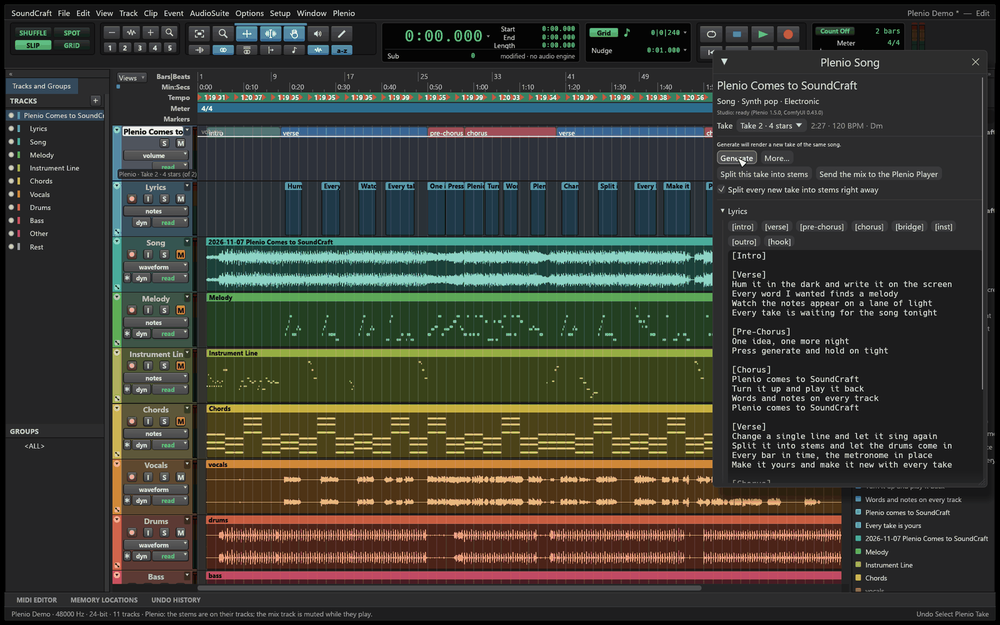
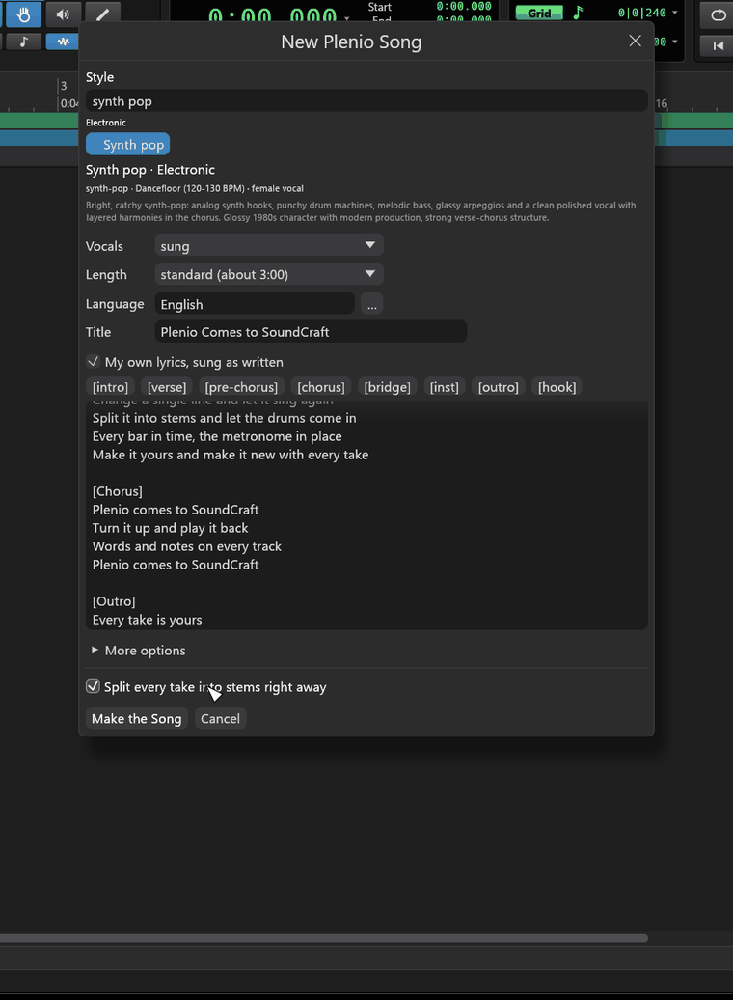
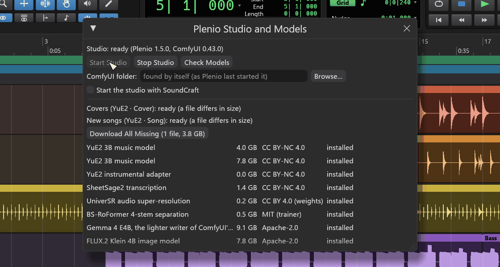

  

# The Plenio add-in: user guide

YuE2 · Song, YuE2 · Cover and the Plenio Player from the
[Plenio Music Production System](https://github.com/jplenio/Plenio-Music-Production-System) by Johannes
Plenio, built into SoundCraft. Version **0.1.0-alpha** ([changelog](CHANGELOG.md)). New here? Start with
the [tutorial](docs/TUTORIAL.md) (▶ [as a video](https://youtu.be/QFgfxBdV52c), 1:52); this guide is the
reference for every menu entry and window. ▶ [The teaser](https://youtu.be/NRKGa-Vvr_k) shows a song made
with the add-in; [the playlist](https://www.youtube.com/playlist?list=PLJfLcDGpXv1s) has every video.

**Contents:** [The Plenio menu](#the-plenio-menu) · [New Song](#new-song) · [New Cover](#new-cover) ·
[The song's tracks](#the-songs-tracks) · [The song inspector](#the-song-inspector) ·
[The audio is the master](#the-audio-is-the-master) · [Studio and Models](#studio-and-models) ·
[Where things are kept](#where-things-are-kept) · [Commands](#commands) ·
[Troubleshooting](#troubleshooting) · [Limits of the alpha](#limits-of-the-alpha) ·
[How it fits into SoundCraft](#how-it-fits-into-soundcraft) · [Licences](#licences)

## The Plenio menu

| Entry | What it does |
|---|---|
| **Activate Plenio Add-in…** | once: accept the models' licences (YuE2 and SheetSage2 are CC BY-NC 4.0, non-commercial), choose whether the studio starts with SoundCraft. The studio starts, and Studio and Models opens |
| **New Song…** | a song from a style, an idea or your own lyrics ([New Song](#new-song)) |
| **New Cover from Selected Track…** | a cover of the recording on the selected audio track ([New Cover](#new-cover)); also in the track's context menu |
| **Import Plenio Song…** | a song Plenio made: its FLAC (which carries the whole song) or its `.plenio.json`. It comes in when the studio is ready; nothing is written into the folder it came from |
| **Song Inspector** | the [inspector](#the-song-inspector) of the selected song |
| **Open Plenio Player** | every song the studio made, with the lyrics as they are sung, the sheet music and the visuals, in your browser |
| **Studio and Models…** | start and stop the studio, choose ComfyUI, download models ([Studio and Models](#studio-and-models)) |
| **Deactivate Plenio Add-in** | the add-in's menu shrinks back and the studio stops; songs stay in their sessions |
| **Getting Started** | the six steps in the app, and links to the tutorial |
| **About the Plenio Add-in** | the version, the studio's state, the licences |

The context menu of a song's track adds **Plenio: Generate**, **Plenio: Song Inspector** and **Plenio: Split
Take into Stems**.

## New Song

| Field | |
|---|---|
| **Style** | one of Plenio's 250 styles; search by name, group, genre (`synth pop`, `jazz`, `ballad`, `female` …). Below the list: what it sounds like. Choosing one also sets vocals and length |
| **Vocals** | sung, sparse vocals (a few phrases) or instrumental |
| **Length** | from about 1:00 to about 6:00; with your own lyrics the words decide |
| **Language** | of the lyrics; the **…** button lists the languages the styles use |
| **Title** | empty: Plenio writes one |
| **What it is about** | a sentence for the lyrics (the style's idea is the hint) |
| **My own lyrics, sung as written** | your lyrics, with YuE2's section tags as buttons |
| **More options** | every other field of the Song API: sound, genre, mood, tempo, key, meter, voice, theme, lead instrument, arrangement, genre closeness, creativity, lyrics fidelity, HQ mastering, cover art, writer model. A field left empty takes the style's value, shown in grey |
| **Split every take into stems right away** | each take comes with its stems; the choice is remembered for the next song |

**Make the Song** opens the inspector and makes the first take. Before the studio described its templates
once, the dialog offers Plenio's built-in choices; afterwards the add-in keeps the studio's description, so
the dialog is complete at once, even while the studio starts.

 

## New Cover

Select the audio track with the recording (a selection on it becomes the excerpt), then **New Cover from
Selected Track…**: the **target style**, **vocals** (original lyrics, new lyrics with what they are about, or
instrumental), the **language** (empty: heard from the singing), the **harmony** (keep the original chords or
a new accompaniment), a title, and **More options** (closeness to the original, closeness of the new lyrics,
notes of the original, arrangement, creativity …). The cover gets a folder of its own with the recording in
it; the recording is muted on the cover's first take. Only cover recordings you may use.

## The song's tracks

| Track | What it holds |
|---|---|
| the song's folder | its lane shows the sections (verse, chorus …); its header the take and what changed |
| **Lyrics** | one clip per sung line, where it is sung |
| **Song** | the take's audio; every take on a playlist of its own |
| **Melody**, **Instrument Line**, **Chords** | the score as MIDI over the whole length of the score, muted (unmute to hear the notes) |
| **Vocals**, **Drums**, **Bass**, **Other**, **Rest** | the stems, when the take was split; together they are exactly the take, and the Song track is muted while they play |
| the recording (covers) | the original, muted on the cover's first take |

They are ordinary SoundCraft tracks: effects, edits, automation, sends. Your own tracks and MIDI clips beside
them stay yours: a new take never moves them from their bar and beat.

## The song inspector

| Part | |
|---|---|
| **Take** | choose the take on the tracks; its length, tempo and key. The lyrics, the score tracks and the tempo map follow |
| **Generate** | does what your changes call for (the line above says what): nothing changed is a new take; new words get new notes; notes you changed on the score tracks are sung as written; a changed brief writes the song anew. **More…** forces one of them |
| **Split this take into stems** | vocals, drums, bass, other and the rest on their tracks (Plenio's BS-RoFormer) |
| **Send the mix to the Plenio Player** | the session's mix with your effects, with the take's lyrics and notes |
| **Split every new take into stems right away** | for this song |
| **Lyrics** | the words of the next take: the section tags as buttons, **Apply**, **Back to the take's**, **Check** (Plenio's YuE2 rules: tags, sections, lines) |
| **Brief** | every field of the song's template, the style by its name; an emptied field takes the style's value again |
| **Seeds and take** | lock a seed to keep that part (draft, plan, arrangement, take, cover) in the next take; put the unmastered take on the track for your own mastering |

Every change in the inspector is one undo step.

## The audio is the master

A YuE2 render keeps no steady tempo: against the best single tempo its beats wander by a quarter of a
second in the median song and by a second in the worst. So no BPM value, however exact, keeps a metronome on
it. The add-in finds every measure of the score in the audio (its onsets, the score's pitch classes, the sung
words) and makes each a tempo change on its bar line. The session's bars are then the take's: metronome,
grid and any MIDI you add stay on the audio, the audio is not changed, and the notes stay on the grid as
written. An intro is often quiet or free, so the bars before the first stretch of the song that is sure are
reckoned back from it at its tempo, unless the score's pitches say the intro really runs slower. Meter changes
of the score become meter changes of the session.

Each take brings its tempo map when you choose it. A session has one tempo map, so with **several songs in
one session the take you chose last conducts it**; the other songs' notes are read in their own bars, so this
is never taken for an edit of their notes. A take whose bars cannot be measured (the status line says so)
lies on the straight line Plenio measured, with its notes stretched to match.

## Studio and Models

- **Start Studio**, **Stop Studio** (frees the graphics card), **Check Models**.
- **ComfyUI folder:** empty finds it by itself (as Plenio last started it, then the usual places);
  **Browse…** chooses one. Used at the next start.
- **Start the studio with SoundCraft.**
- The templates' readiness, and every model file with its size, licence and state; **Download** or
  **Download All Missing**, with progress. Non-commercial models download only after the licences were
  accepted.

The studio is a ComfyUI instance of the add-in's own, in the add-in's settings folder, with Plenio inside;
it uses the ComfyUI and the models already on the computer and never changes your own setup. It stops when
SoundCraft closes, and ends by itself when SoundCraft is gone. If it crashes, the status says so within
seconds.

 

## Where things are kept

| What | Where |
|---|---|
| activation, ComfyUI folder, start with SoundCraft, the last "stems right away" | `<SoundCraft's settings>/Plenio/settings.json` |
| the studio's description of its templates and styles | `<SoundCraft's settings>/Plenio/api-cache.json` |
| the studio: its ComfyUI base folder, log (`comfyui.log`), Plenio Player state | `<SoundCraft's settings>/Plenio/` |
| songs, takes, brief, seeds | in the session file |
| a take's files: FLAC, unmastered take, release record, score as MIDI, stems | beside the saved session in `Plenio/song-<n>/`; for an unsaved session in `<settings>/Plenio/takes/` |

## Commands

Every change is a command, one undo step each, and reachable from SoundCraft's control channel and MCP:

| Command | |
|---|---|
| `plenio.status` | whether the add-in is activated, and the session's songs |
| `plenio.song.new` | `{kind?: song\|cover, title?, fields?, source_track?, stems_right_away?}` |
| `plenio.song.set` | `{song, title?, fields?, documents?, seeds?, unmastered?, source?, stems_right_away?}` |
| `plenio.take.add`, `plenio.take.select` | a take on the song's tracks; choose the take the tracks show |
| `plenio.stems.add` | a take's stems on their tracks |
| `plenio.song.forget` | the song's tracks stay, as ordinary tracks |

## Troubleshooting

| You see | What helps |
|---|---|
| *no ComfyUI found* | Studio and Models › **Browse…** to your ComfyUI folder, then **Start Studio** |
| *n model file(s) missing* | **Download All Missing** |
| *ComfyUI ended (…)* | out of graphics memory, or closed from outside: **Start Studio** again; see `comfyui.log` |
| the first take takes long | the models load at the first take after a start (several minutes) |
| *its bars could not be measured* | the take lies on Plenio's straight line: make another take, or listen with the metronome |
| *came after its session was closed* | a take or stems arrived after you closed or switched the session; the message names the folder with the files |
| the dialogs show few choices | the studio has not described its templates yet: start it once |

## Limits of the alpha

- Used on Windows only so far; macOS and Linux build but are untested.
- Not yet: Plenio's review stops and LoRAs (not in the Song API v1), stopping an idle studio by itself, a
  headless `soundcraft-cli` with the `plenio.*` commands, an installer of the fork's own.
- The add-in's data in the session may still change before 1.0.

## How it fits into SoundCraft

Everything of the add-in lives in this folder. SoundCraft itself has three general entry points for add-ins
(see [docs/architecture.md › Extensions](../../docs/architecture.md#extensions)):

| Entry point | Where | The add-in uses it for |
|---|---|---|
| `Session::extensions` | `crates/model` | its songs, takes and their tracks, under the key `plenio` |
| `register_extension_commands` | `crates/engine` | its commands `plenio.*` |
| `UiExtension` | `crates/ui-egui` | the Plenio menu, its windows, its drawing on tracks |

The app turns the add-in on with the Cargo feature `plenio` of `apps/soundcraft` (on by default in this fork):
`cargo build -p soundcraft --no-default-features` builds SoundCraft without it. The parts, the rules, the tests
and the release: [docs/DEVELOPMENT.md](docs/DEVELOPMENT.md). Keeping the fork up to date: [docs/FORK.md](docs/FORK.md).
The plan, the decisions and their measurements: [docs/PLAN.md](docs/PLAN.md).

## Licences

The add-in's code and documentation are under SoundCraft's licence (MIT OR Apache-2.0); Plenio in `vendor/`
keeps its Apache-2.0 licence and its NOTICE. The models have licences of their own: YuE2 and SheetSage2 are
CC BY-NC 4.0 (non-commercial). Everything in one place: [NOTICE.md](NOTICE.md).
