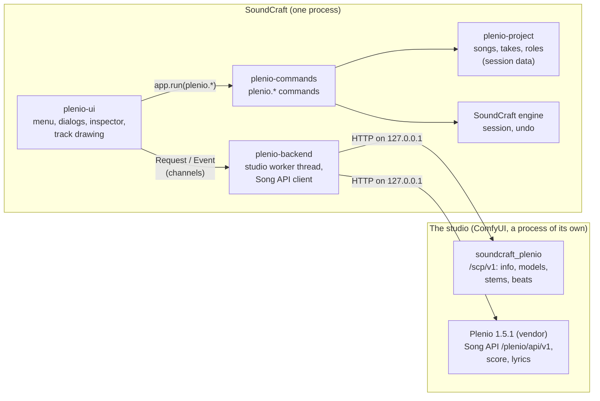
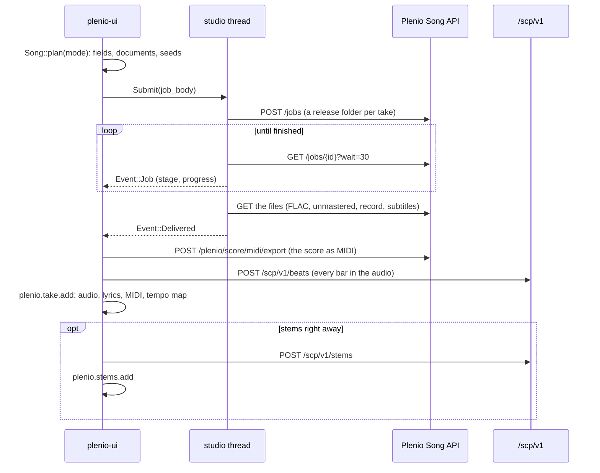

# Developing the Plenio add-in

How the add-in is built, where each part lives, how it is tested and released. For using it, see the
[README](../README.md) and the [tutorial](TUTORIAL.md); for keeping the fork up to date with SoundCraft,
[FORK.md](FORK.md); for the decisions and their reasons, [PLAN.md](PLAN.md).

## The parts



| Crate or folder | Layer | What it holds |
|---|---|---|
| `crates/project` (`soundcraft-plenio-project`) | L2 | Plain data: `Project` (in `Session::extensions["plenio"]`), `Song`, `Take`, `BarMap`, the roles of the song's tracks, and what the next take is made from (`Song::plan`, `Song::changes`). No I/O. |
| `crates/backend` (`soundcraft-plenio-backend`) | L4 | Settings and the cache of the studio's answers, finding ComfyUI (`discover`), the instance (`instance`), the studio worker (`studio`: one thread, plus one per job, download and the player), the Song API client, release records and FLACs (`release`, `song`), the Plenio Player. |
| `crates/commands` (`soundcraft-plenio-commands`) | L4 | The engine commands `plenio.*`: every change of the document, one undo step each; the score on MIDI tracks and back (`score`), the session's tempo map from a take's bars (`score::tempo_map`, `songs::conduct`). |
| `crates/ui` (`soundcraft-plenio-ui`) | L6 | The UI extension: `lib.rs` (state and the studio's events), `generate.rs` (jobs, takes, stems, imports, the player), `fields.rs` (the Song API's fields and the styles), `windows/` (menu and small windows, `song_dialog.rs`, `inspector.rs`), `draw.rs` (lane and header). |
| `backend/soundcraft_plenio` | Python | The ComfyUI package: Plenio's extension unchanged, plus `/scp/v1` (`routes.py`) and the bar search (`beats.py`), and a watch that ends the instance when SoundCraft is gone (`entry.py`). |
| `vendor/plenio` | Python | Plenio, copied byte for byte by `tools/sync_plenio.py` (`VENDOR.toml` names the commit, `VENDOR.sha256` every file). Never edited here. |
| `tools` | | `test_all.ps1`, `update_soundcraft.ps1`, `sync_plenio.py`, `package_windows.ps1`, `media/` |

The layers are SoundCraft's (`cargo xtask layers` checks them); each add-in crate names its layer in
`[package.metadata.soundcraft]`. SoundCraft knows the add-in only through three seams
(`Session::extensions`, `register_extension_commands`, `UiExtension`) and the app's feature `plenio`;
[FORK.md](FORK.md) lists every line the fork changes outside `addins/`.

## Rules

- **Never crash** (SoundCraft's first rule): no `unwrap`, `expect`, `panic!` or `unsafe` outside tests;
  every crate root carries the `deny` attribute. Whatever comes from files, the studio or a command's
  parameters is hostile: bounded, checked, never indexed blindly.
- **Everything is a command.** The UI never edits the session itself: it runs `plenio.*` (or one of
  SoundCraft's commands), so undo, the control channel and MCP see the same steps. A command that
  fails tells the owner why (`run_or_say`), it is never dropped silently.
- **The UI thread never waits.** Network, processes and files run on the studio's threads; the UI sends
  a `Request` and reads `Event`s once a frame (`Studio::poll`).
- **The Song API decides the fields.** The dialogs and the inspector draw whatever `GET /templates/{id}`
  and `GET /briefs` describe (`fields.rs`); a field a later Plenio adds needs no change here. The answers
  are cached in `Plenio/api-cache.json`, so the dialogs are complete before the studio is ready.
- **English only** in code, comments, docs and UI text. Glyphs in UI text: only those SoundCraft's fonts
  have (`›`, `·`, `…`, `—`); others make the offscreen renders of the tests fail.

## A take, from Generate to the tracks



What is kept where:

| What | Where |
|---|---|
| Activation, ComfyUI folder, start with SoundCraft, the last "stems right away" | `<SoundCraft settings>/Plenio/settings.json` |
| The studio's description of its templates and styles | `<SoundCraft settings>/Plenio/api-cache.json` |
| The studio: its ComfyUI base folder, custom node, output, log | `<SoundCraft settings>/Plenio/comfyui/`, `comfyui.log` |
| Songs, takes, roles, brief, seeds | the session file (`Session::extensions["plenio"]`) |
| A take's files (FLAC, unmastered take, record, score MIDI, stems) | beside the saved session in `Plenio/song-<id>/`, else in `<settings>/Plenio/takes/` |

## Tests

```powershell
pwsh addins/plenio/tools/test_all.ps1                 # every check of the add-in (a few minutes)
pwsh addins/plenio/tools/test_all.ps1 -Full           # also SoundCraft's whole test suite
pwsh addins/plenio/tools/test_all.ps1 -Live           # also starts the studio and the player for real
pwsh addins/plenio/tools/test_all.ps1 -Plenio <checkout>   # also Plenio's own unit tests on the copy
```

`test_all.ps1` runs fmt, clippy (`-D warnings`), layers, assets, the add-in's Rust tests, the seams' tests
in SoundCraft, the wrapper's Python tests with ComfyUI's Python, the check that the copy of Plenio is
unchanged, and that the fork carries no ArtCraft marks. The UI tests draw every window without a studio.

Through the real UI, offscreen (the examples of `crates/ui`):

| Example | What it does | Studio |
|---|---|---|
| `plenio_shot [folder] [config]` | renders the menu and every dialog to PNG, in seconds: look at a UI change here first | no |
| `plenio_tour <tour.json> <folder>` | clicks through activation, a song with typed lyrics and stems right away, a second take, a cover and an import; saves every screenshot of the README and the tutorial, and the frames of the animations | yes, about 20 min |
| `plenio_e2e <folder>` | a song from the dialog's defaults, its stems, the mix to the player; prints how audio, words and notes meet | yes |
| `plenio_cover_e2e`, `plenio_import_e2e` | a cover of a recording; a Plenio FLAC through the menu | yes |

```powershell
cargo run -p soundcraft-plenio-ui --example plenio_shot -- out D:\SoundCraft\settings
cargo run --release -p soundcraft-plenio-ui --example plenio_tour -- addins/plenio/docs/media/tour.json D:\tour
```

The tour fails loudly when a label it clicks is gone: when a dialog's wording changes, change it there too.

## Updating Plenio

```powershell
python addins/plenio/tools/sync_plenio.py <Plenio checkout>   # copy, write VENDOR.toml and VENDOR.sha256
python addins/plenio/tools/sync_plenio.py --check             # is the copy unchanged?
pwsh addins/plenio/tools/test_all.ps1 -Live -Plenio <checkout>
```

Run Python against the copy only with `-B` (no `__pycache__` in `vendor/`). The Song API only adds within
v1; read `vendor/plenio/docs/api/README.md` for what changed, and run the tour once.

## Media

| What | How |
|---|---|
| `logo.svg` | by hand; `docs/media/src/` holds the banner and social preview as HTML and CSS |
| `logo-512.png`, `banner.png`, `social-preview.png` | `python addins/plenio/tools/media/render_brand.py` (headless Edge or Chrome) |
| screenshots and animations of the README and the tutorial | the tour, then `python addins/plenio/tools/media/make_media.py <tour folder>` |
| the teaser | `python addins/plenio/tools/media/make_teaser.py <tour folder> <out folder>` (Pillow, NumPy, OpenCV, soundfile, ffmpeg): 16:9 and 9:16, its scenes on the song's measured bars and sung lines |
| the tutorial video | `python addins/plenio/tools/media/make_tutorial.py <tour folder> <out.mp4>`: chapters of the tour's frames, a camera on the part of the window each step is about, captions |
| both | their music is a song of the tour (YuE2, CC BY-NC 4.0), so they are not in the repository; a list of seconds as the last argument writes only those frames, as PNG, to look at |

Every committed image needs its row in the root `ATTRIBUTION.md` (`cargo xtask assets`).

## Releasing

1. Set the version in the four `crates/*/Cargo.toml` (`version = "0.1.1-alpha"`), and in `CHANGELOG.md`.
2. `pwsh addins/plenio/tools/test_all.ps1 -Full` and the tour.
3. `pwsh addins/plenio/tools/package_windows.ps1` builds `target/plenio-dist/soundcraft-plenio-<version>-windows-x64-portable.zip`
   and `SHA256SUMS.txt`: SoundCraft with the add-in and its Python files beside it (`plenio-addin/`).
   `pwsh addins/plenio/tools/smoke_package.ps1 -Shot <png>` starts the packaged program once, asks the add-in for its
   version through the control channel, takes a screenshot and quits (a window opens for a few seconds).
4. Tag `plenio-v<version>`, push, and make a GitHub release from `docs/release/` - marked as pre-release
   while the version has a suffix. SoundCraft's updater skips pre-releases and tags it cannot read, so an
   alpha never replaces anybody's build.
