

# Tutorial: make, cover and bring in songs with Plenio in SoundCraft

In about half an hour you make a song from your own lyrics, give it a second take, split it into stems,
cover it in another style and bring a song in that Plenio made elsewhere. Every picture here is a real
screenshot of these steps, made by the add-in's [tour](DEVELOPMENT.md#tests).

▶ **As a video (under two minutes):** [on YouTube](https://youtu.be/QFgfxBdV52c), or `plenio-tutorial.mp4`
on the [release page](https://github.com/jplenio/soundcraft-plenio/releases/tag/plenio-v0.1.0-alpha).
New videos join [the playlist](https://www.youtube.com/playlist?list=PLJfLcDGpXv1s).

**What you need:** SoundCraft with the Plenio add-in (the [release](https://github.com/jplenio/soundcraft-plenio/releases)
or a build of this repository), [ComfyUI](https://github.com/comfyanonymous/ComfyUI) 0.37 or later on the
same computer, and a graphics card with 16 GB (YuE2 renders on it). The models are downloaded by the add-in.

**Contents**

1. [Activate the add-in](#1-activate-the-add-in)
2. [Make a song](#2-make-a-song)
3. [The song on its tracks](#3-the-song-on-its-tracks)
4. [Change it and make it again](#4-change-it-and-make-it-again)
5. [Stems](#5-stems)
6. [Cover a song](#6-cover-a-song)
7. [Bring in a Plenio song](#7-bring-in-a-plenio-song)
8. [Mix and play it in the Plenio Player](#8-mix-and-play-it-in-the-plenio-player)
9. [When something does not work](#9-when-something-does-not-work)

---

## 1. Activate the add-in

Open the **Plenio** menu in SoundCraft's menu bar and choose **Activate Plenio Add-in…**.

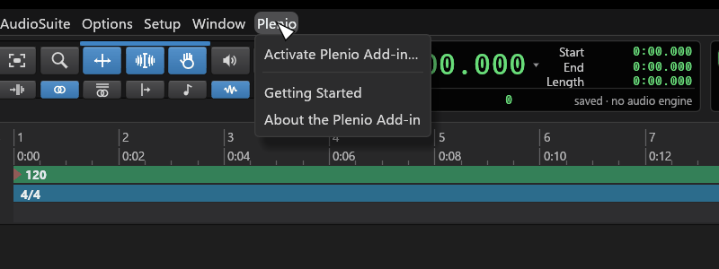

The window says what happens: the add-in runs **its own ComfyUI instance** with Plenio inside. It uses
the ComfyUI and the models already on your computer, and leaves your own ComfyUI setup as it is.
YuE2 and SheetSage2 are licensed **CC BY-NC 4.0**: what you make with them is for non-commercial use.
Tick **I accept the models' licences**, decide whether the studio starts with SoundCraft, and click
**Activate**.

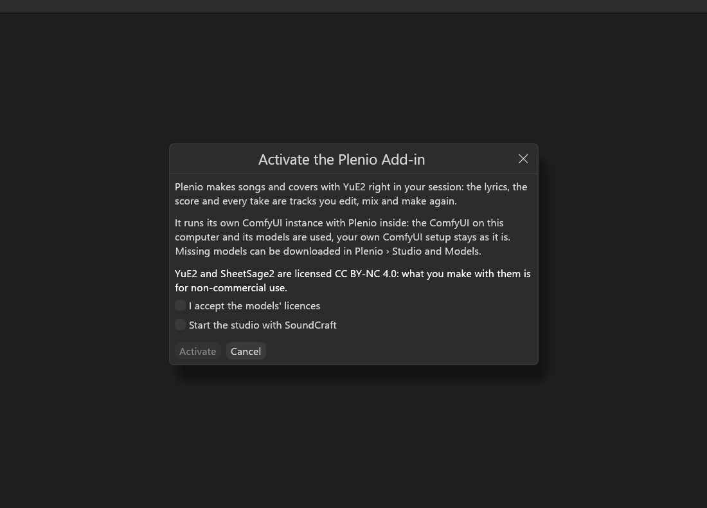

**Plenio › Studio and Models** opens by itself. The studio starts (the first start takes up to a minute)
and lists every model the YuE2 templates need. Missing ones show a **Download** button, and
**Download All Missing** fetches them all at once.

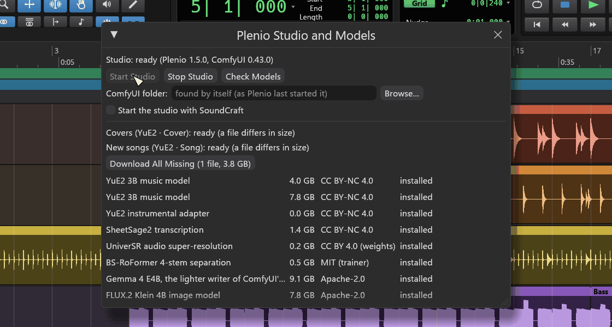

> **Tip:** Plenio › **Getting Started** shows these steps in the app at any time.

## 2. Make a song

**Plenio › New Song…** opens the dialog for a new song.

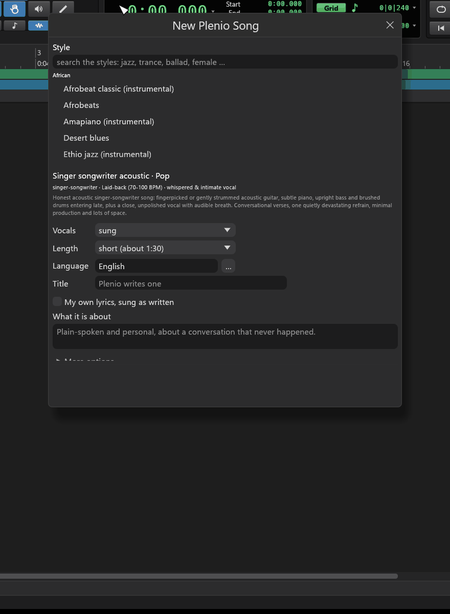

1. **Style:** type into the search (`synth pop`, `jazz`, `ballad`, `female` …) and pick one of Plenio's
   250 styles. Under the list you read what it sounds like; it also sets vocals and length.

   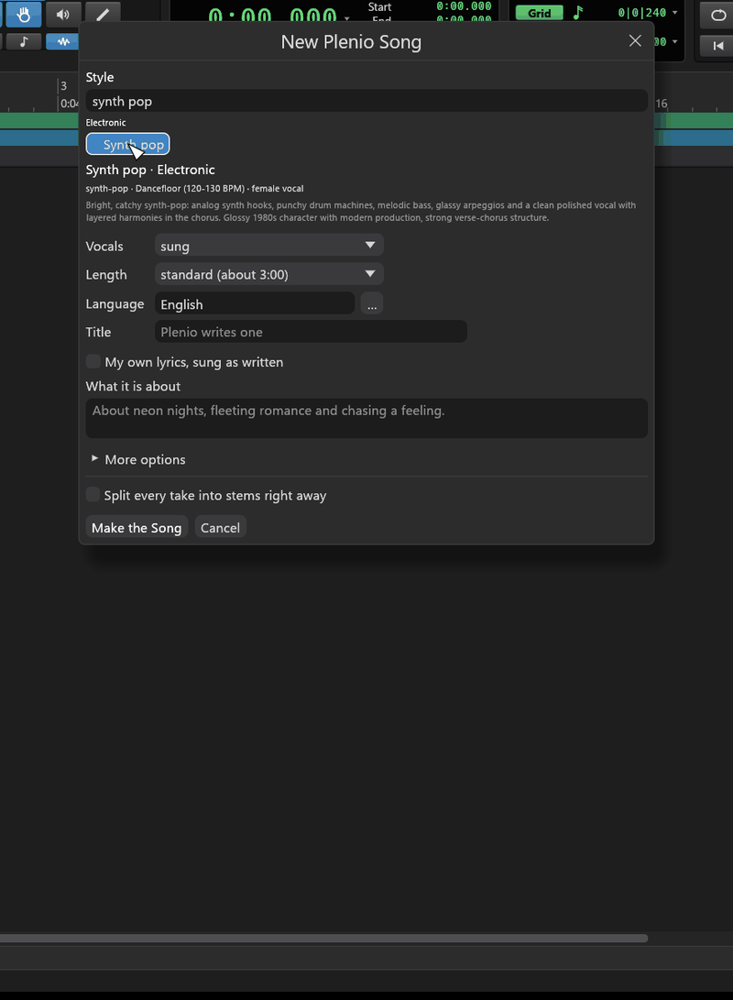

2. **Vocals, Length, Language, Title:** as you like. An empty title is written by Plenio.
3. **What it is about:** a sentence for the lyrics - or tick **My own lyrics, sung as written** and write
   them yourself. The section buttons (`[verse]`, `[chorus]` …) insert YuE2's section tags.

   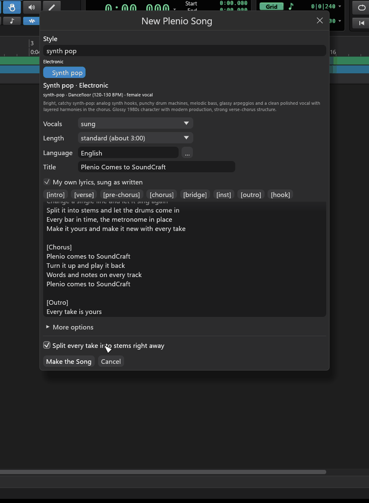

4. **More options** holds every other field of Plenio's Song API: genre, mood, tempo, key, meter, voice,
   arrangement, creativity, lyrics fidelity, HQ mastering, cover art, the writer model. A field left
   empty takes the style's value, which it shows in grey.

   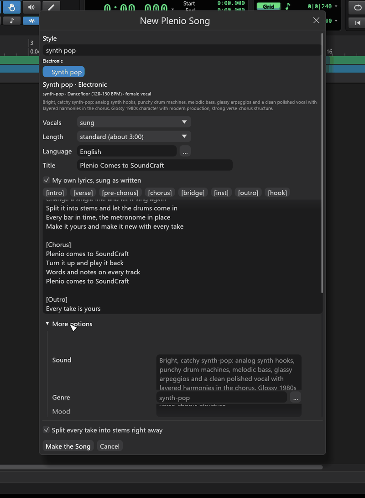

5. Tick **Split every take into stems right away** if you want the stems without asking for them.
6. **Make the Song.**

The **Plenio Song** inspector opens and follows the studio: writing the lyrics, composing, singing and
playing, mastering and saving. A song of about two minutes takes three to six minutes; the first one after
the studio started takes longer, while the models load.

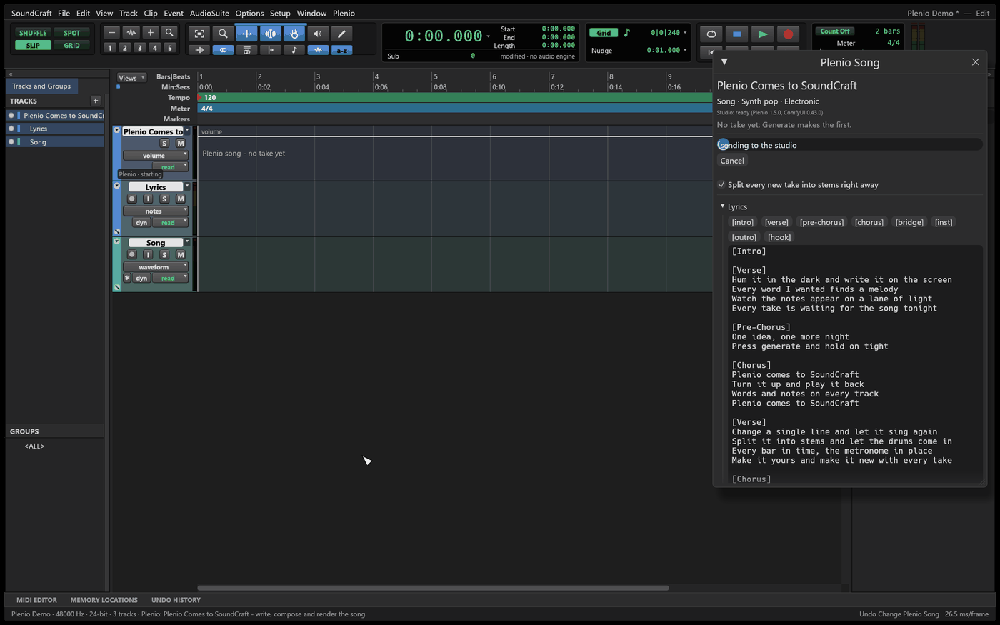

## 3. The song on its tracks

When the take is done, the song lands on a **folder track** named after it:

| Track | What it holds |
|---|---|
| the folder | the song's sections (verse, chorus …) on its lane; its header shows the take and what changed |
| **Lyrics** | one clip per sung line, where it is sung |
| **Song** | the take's audio; every take on a playlist of its own |
| **Melody**, **Instrument Line**, **Chords** | the score as MIDI, muted (unmute them to hear the notes) |

**The audio is the master.** A YuE2 render keeps no steady tempo, so the add-in finds every measure of the
score in the audio and puts a tempo change on each bar line. Metronome, grid and any MIDI you add stay on
the music; the audio itself is never stretched. The status line says how far the tempo moves
(for example *124.5 to 128.3 BPM*).

## 4. Change it and make it again

The inspector shows what the next **Generate** will do, from what you changed:

| You change | Generate |
|---|---|
| nothing | renders a new take of the same song |
| the lyrics (**Apply** in the inspector) | composes new notes for the new words, then renders |
| notes on Melody, Instrument Line or Chords | renders a take that sings your notes |
| the brief (style, genre, mood … in **Brief**) | writes the song anew |

**More…** next to Generate forces one of them. Under **Seeds and take** you lock a seed, so the next take
keeps that part (for example the arrangement) and draws only the rest anew. Here nothing was changed, so
Generate made a second take:

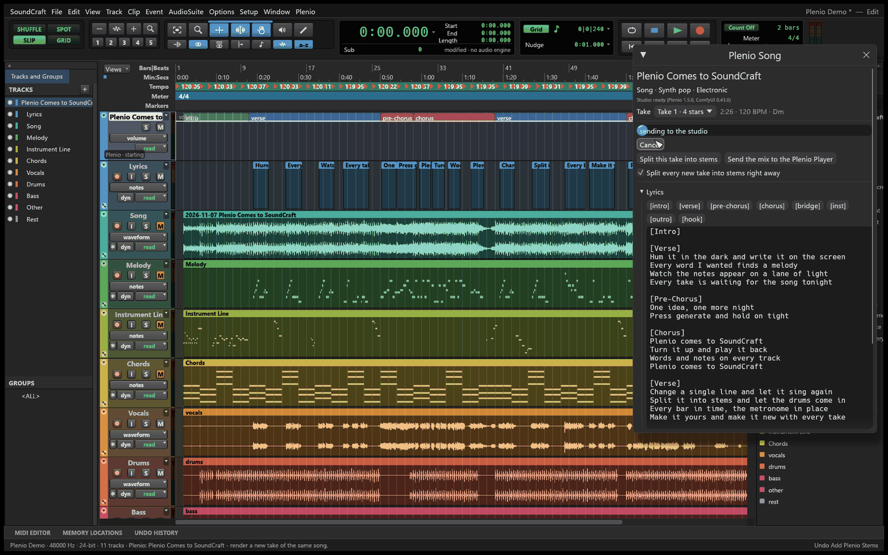

Switch between takes in the inspector's **Take** list: the tracks, the lyrics and the tempo map follow.
Your own MIDI clips keep their bar and beat.

## 5. Stems

**Split this take into stems** (in the inspector, or in the context menu of a song track) puts the take's
vocals, drums, bass, other and the rest on tracks of their own - together they are exactly the take. The
song track is muted while the stems play. With **Split every new take into stems right away** this
happens by itself for every new take.

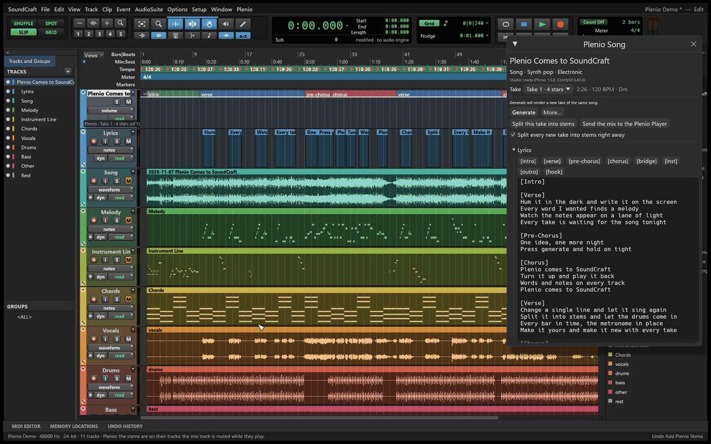

Stems are ordinary SoundCraft tracks: put effects on them, edit, automate, mute the drums and record your
own.

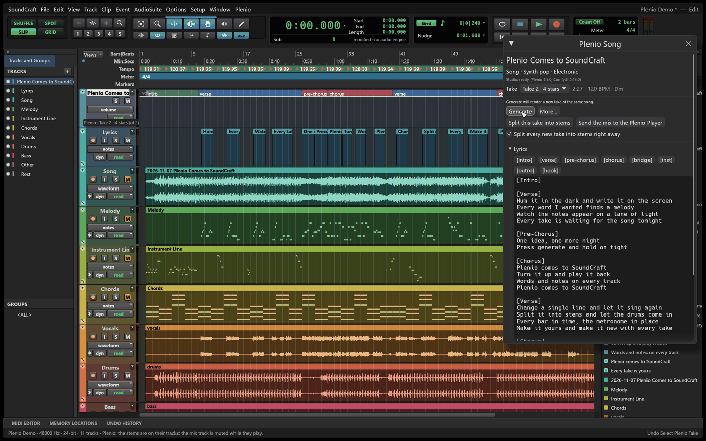

## 6. Cover a song

A cover keeps the melody, form and tempo of a recording and plays it in another style.

1. Put the recording on an audio track (**File › Import › Audio…**) and select the track. To cover only a
   part, select that part on the track: it becomes the excerpt.
2. **Plenio › New Cover from Selected Track…** (or the track's context menu).
3. Pick the **target style**, choose **original lyrics**, **new lyrics** (and what they are about) or
   **instrumental**, keep the original chords or ask for a new accompaniment, and **Make the Cover**.

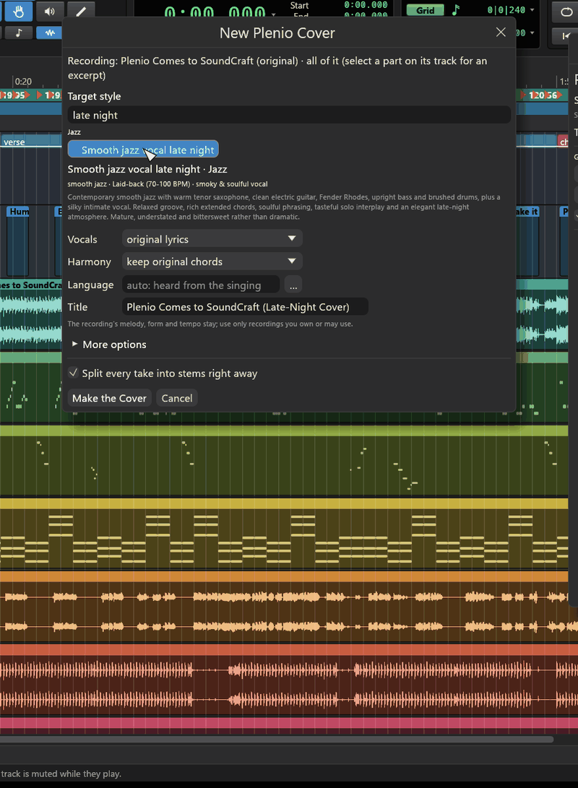

The cover gets a folder of its own, with the recording inside, muted on the first take so you hear the
cover:

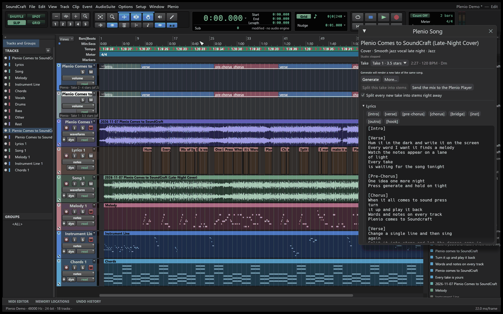

> Only cover recordings you may use: the models' licences do not cover the rights of a composition.

## 7. Bring in a Plenio song

A song made with Plenio in ComfyUI carries its whole making in its FLAC. **Plenio › Import Plenio Song…**
and choose the FLAC (or its `.plenio.json`):

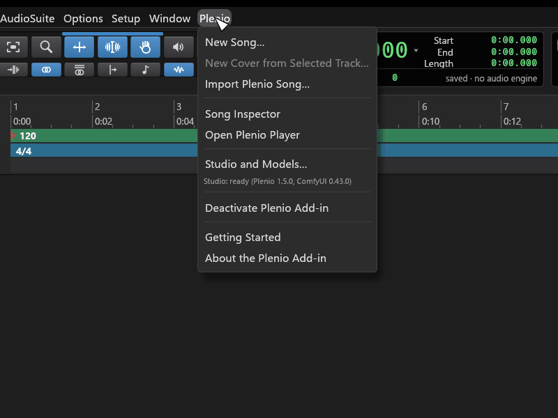

The song comes in with its take, lyrics, score and tempo map, ready to change and make again. Nothing is
written into the folder it came from.

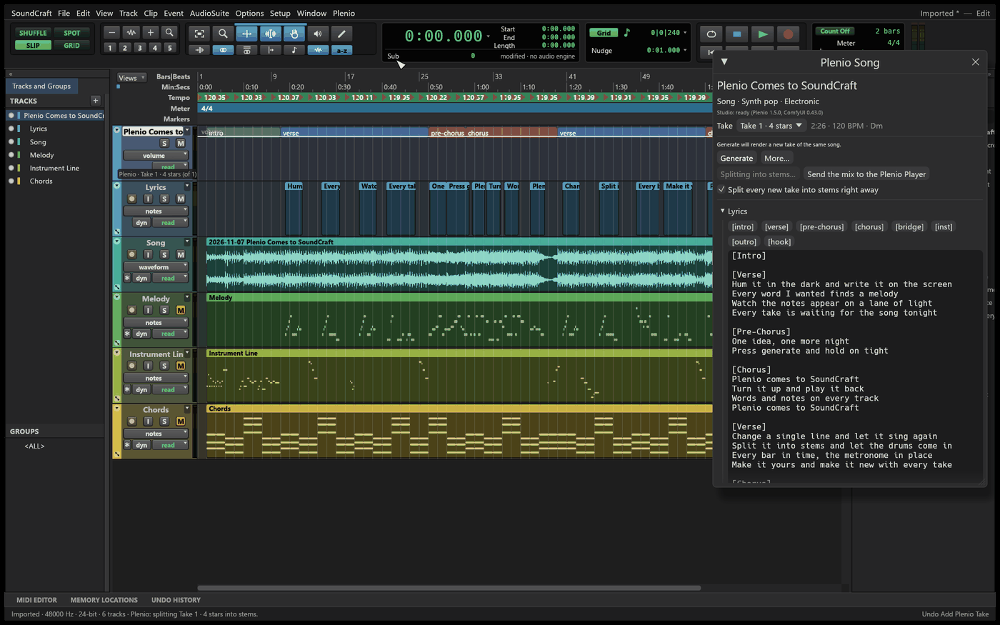

## 8. Mix and play it in the Plenio Player

**Send the mix to the Plenio Player** (in the inspector) bounces the session's mix with your effects and
opens it in the Plenio Player in your browser, with the take's lyrics as they are sung and its notes.
**Plenio › Open Plenio Player** shows every song the studio made.

## 9. When something does not work

| You see | What helps |
|---|---|
| *no ComfyUI found* | Plenio › Studio and Models: choose your ComfyUI folder (**Browse…**), then **Start Studio** |
| *n model file(s) missing* | **Download All Missing** in Studio and Models |
| *ComfyUI ended (…)* | the graphics card ran out of memory, or ComfyUI was closed: **Start Studio** again; the log is `comfyui.log` in the add-in's folder |
| a take takes very long | the first take after a start loads the models (several minutes); `GET /queue` of the Song API shows recent times |
| *its bars could not be measured* | the take lies on Plenio's straight line; make another take, or check the tempo by ear with the metronome |
| the dialogs show few choices | the studio has not described its templates yet: start it once, the add-in keeps them for later |

Problems and ideas: [issues](https://github.com/jplenio/soundcraft-plenio/issues).
