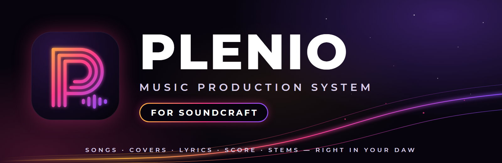

<!-- The body of the GitHub release `plenio-v0.1.0-alpha`, titled
     "Plenio for SoundCraft 0.1.0-alpha". Mark it as a pre-release. Each paragraph and list item is one
     line, since GitHub shows every line break of a release's text: paste everything below this comment. -->

**Plenio comes to SoundCraft.** The first alpha of the Plenio add-in: songs and covers made with YuE2 right in an open-source DAW, with their lyrics, score, takes and stems as tracks you edit, mix and make again. Everything runs on your own computer.

▶ **[Teaser](https://youtu.be/NRKGa-Vvr_k)** (72 s; its music was made with this release) · ▶ **[Tutorial video](https://youtu.be/QFgfxBdV52c)** (1:52) · 📖 **[Tutorial](https://github.com/jplenio/soundcraft-plenio/blob/plenio-addin/addins/plenio/docs/TUTORIAL.md)** · 📋 **[Changelog](https://github.com/jplenio/soundcraft-plenio/blob/plenio-addin/addins/plenio/CHANGELOG.md)**

## What it does

- **New Song:** pick one of 250 styles, say what the song is about or write your own lyrics; every option of Plenio's Song API is there under *More options*.
- **The song on tracks:** a folder per song with the lyrics (a clip per sung line), the audio (each take on its own playlist) and the score as MIDI (melody, instrument line, chords).
- **The audio is the master:** every bar of the take becomes a tempo change of the session, so metronome, grid and your own MIDI stay on the music, and the audio is never stretched.
- **Make it again:** change words, notes or the brief, and Generate makes what the change calls for.
- **Stems:** vocals, drums, bass, other and the rest on their own tracks, on request or right away.
- **Covers** of any recording in another style, **imports** of songs Plenio made in ComfyUI, and the **Plenio Player** for the finished mix.

## Download

| File | For |
|---|---|
| `soundcraft-plenio-0.1.0-alpha-windows-x64-portable.zip` | Windows 10 and 11 (x64): unzip anywhere, run `soundcraft.exe` |
| `plenio-comes-to-soundcraft.mp4` | the teaser (1920 x 1080, 72 s) |
| `plenio-comes-to-soundcraft-vertical.mp4` | the teaser for phones (1080 x 1920) |
| `plenio-tutorial.mp4` | the tutorial as a video: make, change, cover and bring in a song (1:52) |
| `SHA256SUMS.txt` | the checksums of the files |

macOS and Linux: build from source (`cargo run --release -p soundcraft`, see the README). They are not tested yet.

## What you need

- **ComfyUI 0.37 or later** installed on the same computer (the add-in finds it and runs an instance of its own; your setup stays as it is).
- **An NVIDIA graphics card with 16 GB** (tested: RTX 5060 Ti 16 GB). A song of two minutes takes three to six minutes.
- **About 35 GB of disk** for the models, which the add-in downloads (Plenio › Studio and Models).

## Alpha: what to know

- Tested on Windows only. The program is not signed, so Windows SmartScreen asks before the first start.
- **Songs made with YuE2 are for non-commercial use** (YuE2 and SheetSage2: CC BY-NC 4.0); you accept this when you activate the add-in. Only cover recordings you may use.
- The session format of the add-in's data may still change before 1.0.
- Not yet: Plenio's review stops and LoRAs (not in the Song API v1), an automatic stop of an idle studio (use *Stop Studio* to free the graphics card), a headless `soundcraft-cli` with the `plenio.*` commands.
- SoundCraft's updater does not offer pre-releases, so this alpha never replaces a build by itself.

## Licence

The add-in and this fork: MIT OR Apache-2.0. Plenio (in `addins/plenio/vendor`): Apache-2.0. The models have licences of their own (see `addins/plenio/NOTICE.md`). This fork of SoundCraft is independent and not made or endorsed by the SoundCraft team.

## Thanks

To the authors of [YuE](https://github.com/multimodal-art-projection/YuE) (Multimodal Art Projection), SheetSage, BS-RoFormer and ComfyUI, and to the SoundCraft contributors for an open DAW to build on.
