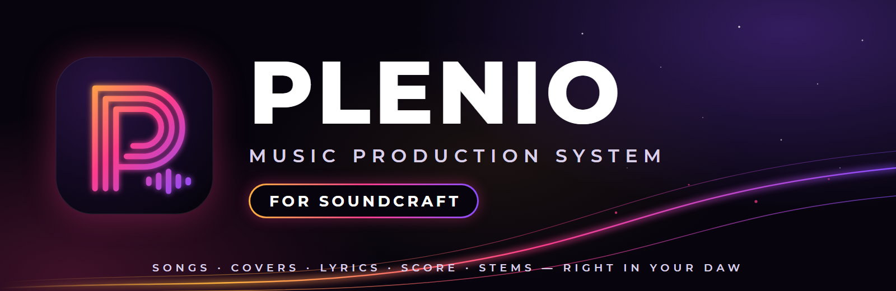

<!-- The body of the GitHub release `plenio-v0.1.1-alpha`, titled
     "Plenio for SoundCraft 0.1.1-alpha". Mark it as a pre-release. Each paragraph and list item is one
     line, since GitHub shows every line break of a release's text: paste everything below this comment. -->

**Plenio for SoundCraft 0.1.1-alpha** puts the add-in on the released SoundCraft 0.18.0 and Plenio 1.5.1. Songs and covers made with YuE2 right in an open-source DAW, with their lyrics, score, takes and stems as tracks you edit, mix and make again, on your own computer.

▶ **[Teaser](https://youtu.be/NRKGa-Vvr_k)** (72 s) · ▶ **[Tutorial video](https://youtu.be/QFgfxBdV52c)** (1:52) · ▶ **[Every video](https://www.youtube.com/playlist?list=PLJfLcDGpXv1s)** · 📖 **[Tutorial](https://github.com/jplenio/soundcraft-plenio/blob/plenio-addin/addins/plenio/docs/TUTORIAL.md)** · 📋 **[Changelog](https://github.com/jplenio/soundcraft-plenio/blob/plenio-addin/addins/plenio/CHANGELOG.md)**

## What is new

- **SoundCraft 0.18.0:** the release of the code 0.1.0-alpha was built on. The program now names itself 0.18.0.
- **Plenio 1.5.1** in the studio, installed by itself at the studio's next start. Its features (notes fitted to their lyrics, locked tracks, your own lyrics sung exactly as written, Gemma 4 12B as the default writer) were already in 0.1.0-alpha's copy, which was taken just before Plenio's release.
- **The videos are on YouTube**, linked from the README, the user guide and the tutorial.

The add-in itself works as in 0.1.0-alpha: this release brings it onto the released versions of both.

## Upgrading from 0.1.0-alpha

Unzip into a new folder and start `soundcraft.exe` from there. The activation and the studio's settings are kept in SoundCraft's settings folder and your songs in your sessions, none of them beside the program, so the new version finds them all; the studio installs Plenio 1.5.1 when it starts. The old folder can then be deleted.

## Download

| File | For |
|---|---|
| `soundcraft-plenio-0.1.1-alpha-windows-x64-portable.zip` | Windows 10 and 11 (x64): unzip anywhere, run `soundcraft.exe` |
| `SHA256SUMS.txt` | the checksum of the zip |

The teaser and the tutorial as video files stay with [0.1.0-alpha](https://github.com/jplenio/soundcraft-plenio/releases/tag/plenio-v0.1.0-alpha). macOS and Linux: build from source (`cargo run --release -p soundcraft`, see the README). They are not tested yet.

## What you need

- **ComfyUI 0.37 or later** installed on the same computer (the add-in finds it and runs an instance of its own; your setup stays as it is).
- **An NVIDIA graphics card with 16 GB** (tested: RTX 5060 Ti 16 GB). A song of two minutes takes three to six minutes.
- **About 35 GB of disk** for the models, which the add-in downloads (Plenio › Studio and Models).

## Alpha: what to know

- Tested on Windows only. The program is not signed, so Windows SmartScreen asks before the first start.
- **Songs made with YuE2 are for non-commercial use** (YuE2 and SheetSage2: CC BY-NC 4.0); you accept this when you activate the add-in. Only cover recordings you may use.
- The session format of the add-in's data may still change before 1.0.
- Not yet: Plenio's review stops and LoRAs (not in the Song API v1), an automatic stop of an idle studio (use *Stop Studio* to free the graphics card), a headless `soundcraft-cli` with the `plenio.*` commands.
- SoundCraft's updater does not offer pre-releases, so this alpha never replaces a build by itself.

## Licence

The add-in and this fork: MIT OR Apache-2.0. Plenio (in `addins/plenio/vendor`): Apache-2.0. The models have licences of their own (see `addins/plenio/NOTICE.md`). This fork of SoundCraft is independent and not made or endorsed by the SoundCraft team.
